# 裕泰通加热器控制软件使用说明书

RS485Control 1.0.0　2026年10月

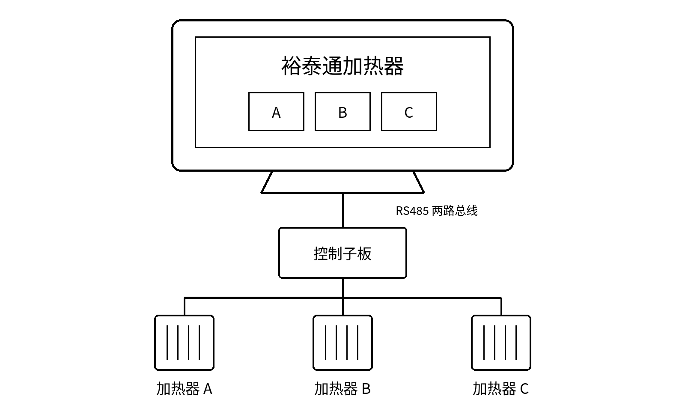

两路 RS485 · 三路温湿度 · 两路 PT100 · 三个加热器

用于子板选择、加热器操作、自动温控设置及报警处理。

首次使用，按第 1～3 节操作。出现报警，查阅第 7 节。

<!-- pagebreak -->

## 使用前检查

- 确认供电、RS485、探头和加热器接线已验收。
- 确认设备日期、时间正确。
- 按现场传感器核对高压检测方式和触发条件。
- 核对 A、B、C 输出组与接线，三个加热器不得共用输出组。

**注意**　插图中的读数和参数为示例。操作时以设备已保存的设置和现场验收值为准。

### 查找操作

| 操作 | 入口 | 节次 |
| --- | --- | --- |
| 选择子板 | 域控子板总览 | 1 |
| 手动加热 | 子板手自控制 | 2 |
| 设置并启动自动温控 | 加热参数设置 | 3 |
| 阈值与 PID 参数 | 加热参数设置 | 4 |
| 防凝露参数 | 加热参数设置 | 5 |
| 查看运行及停止加热 | 子板手自控制 | 6 |
| 处理报警 | 顶部状态提示 | 7 |
| 实体按键与输出接线 | 高级设置 → 接口配置 | 8～9 |
| 高压检测与继电器间隔 | 高级设置 → 安全保护 | 10 |
| 主题、亮度、提示音 | 高级设置 → 显示与声音 | 11 |
| 历史数据 | 数据浏览 | 12 |
| 记录周期与日志清理 | 高级设置 → 数据存储 | 13 |
| 故障排查与交接 | — | 14 |

**确认执行**　操作后检查档位回读和现场负载。按钮变色或提示音响起，仅表示操作反馈。

<!-- pagebreak -->

## 01 选择子板

域控子板总览

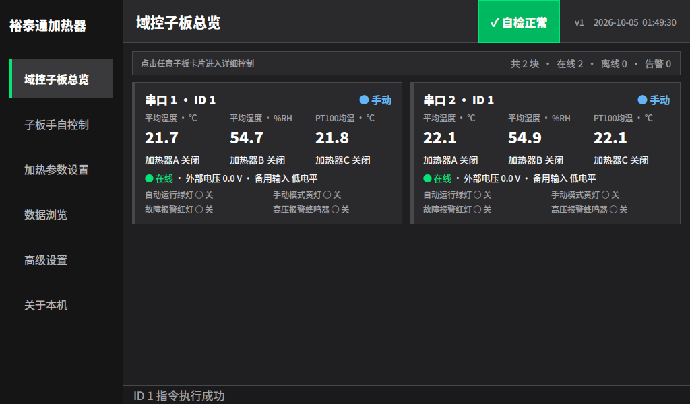

图 1　卡片上方：串口与 ID。卡片中部：测量值与档位。

1. 等待子板出现，查看在线、离线和告警数量。
2. 核对目标卡片的串口和 ID，再点击卡片。
3. 在“子板手自控制”上方再次核对子板，确认在线。
4. 检查测量值和“最后更新”时间持续刷新。

**注意**　不同串口上的相同 ID 是不同子板，必须同时核对串口和 ID。

### 搜索多块子板

启动时，每个启用串口找到第一块子板后停止搜索。查找同一总线上的其他子板时，进入“加热参数设置”，点击“重新扫描子板”。

重新扫描停止全部自动温控，并重建列表。扫描后逐块重新启动。高压告警期间禁止重扫。

蓝色表示手动，绿色表示自动运行或输出打开，红色表示告警或联锁。以文字和回读为准。离线或读数占位符不表示温度为零，也不表示负载已断电。

<!-- pagebreak -->

## 02 手动加热

子板手自控制

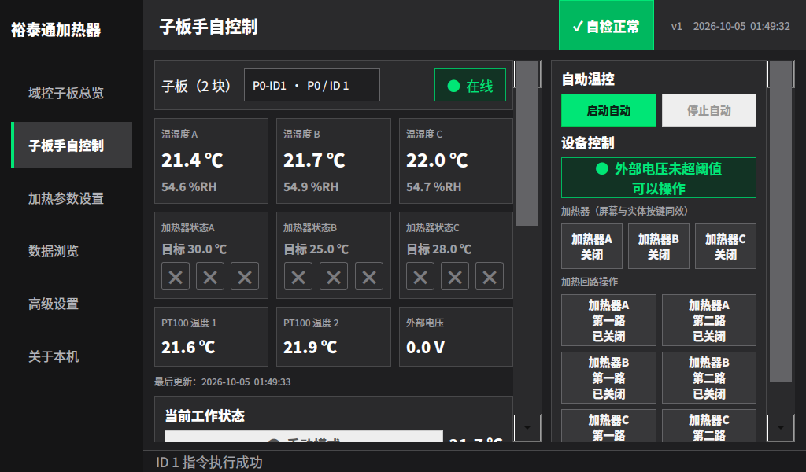

图 2　左侧查看档位，右侧操作同名加热器。

1. 选择子板，确认在线、读数完整且无联锁。
2. 自动运行时，先点击“停止自动”，确认三个加热器关闭。
3. 点击“加热器A”“加热器B”或“加热器C”，切换一档。
4. 检查档位、工作灯和负载。试运行结束，按至关闭。

图 3　每按一次前进一档。1 档接通第一路，2 档接通第二路，3 档两路同开。

实体按键使用同一循环。按下切一档，释放后再按；保持闭合不连续切档。短按未被采集时，检查输入状态后重新操作。

“加热回路操作”只改变所点击的回路，用于维护人员逐路核对接线。出现“写入失败”时，检查通信及实际负载。

<!-- pagebreak -->

## 03 设置并启动自动温控

加热参数设置

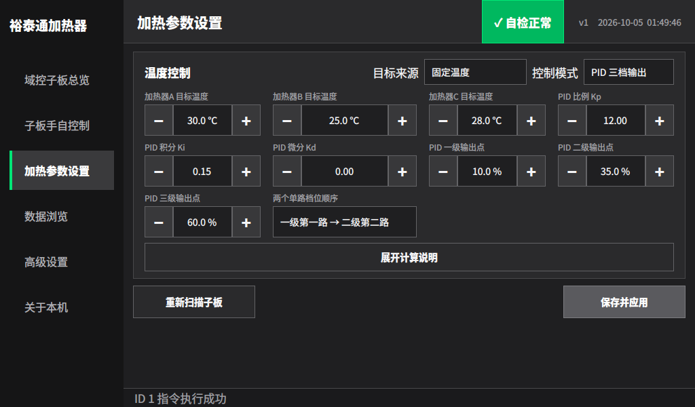

图 4　先设置参数并保存，再到控制页启动子板。

1. 选择固定阈值、PID 三档输出或防凝露模式。
2. 阈值或 PID 模式下，选择目标来源。固定温度分别设置 A、B、C 目标；跟随内部 PT100 使用本子板有效 PT100 均温。
3. 设置当前模式参数，核对“两个单路档位顺序”。
4. 点击“展开计算说明”核对边界，再点击“保存并应用”。
5. 出现“配置已保存并应用”后，回控制页选择子板，点击“启动自动”。

**确认**　显示“本子板自动温控运行中”。核对目标摘要和档位。其他子板须分别选择并启动。

### 参数保存

温控参数由全部子板共用。保存后，正在自动运行的子板也使用新参数；启停只作用于当前子板。固定目标可设 -20～80 ℃。需要观察修改效果时，在允许停机的条件下先停止相关子板。

离开有未保存修改的页面时：“保存并切换”保存后离开；“不保存”撤销本页修改；“取消”留在本页。高级设置内切换分组后，仍需统一保存。

<!-- pagebreak -->

## 04 阈值与 PID 参数

### 固定阈值

温差 = 目标温度 − 有效外部平均温度。温差增大时升档，减小时降档。

| 参数 | 随附值 | 作用 |
| --- | --- | --- |
| 一级／二级／三级温差 | 0.3／1.5／3.0 ℃ | 对应三个加热档位 |
| 切档回差 | 0.2 ℃ | 升档边界加回差，降档边界减回差 |

例如目标 25 ℃：从关闭开始，外部均温降至 24.5 ℃时达到一级升档条件；一级降回关闭的边界为 24.9 ℃。回差避免边界附近反复切档。

### PID 三档输出

PID 根据当前温差、累计温差及变化速度，计算 0～100% 加热需求，再转换为档位。百分比用于档位判定，不表示继电器按比例连续调功。

| 参数 | 随附值 | 作用 |
| --- | --- | --- |
| Kp／Ki／Kd | 12／0.15／0 | 偏差响应／累计修正／变化响应 |
| 一级／二级／三级输出点 | 10%／35%／60% | 低于一级点关闭，达到各点切至对应档位 |

PID 预览按“此前稳定在目标、积分为零，随后 1 秒内突发降温”计算。预览温度不是固定启动温度。

### 核对要求

- 三个加热器共用本子板有效外部均温；固定目标分别设置。探头 A 不单独对应加热器 A。
- 跟随 PT100 时，一路有效即可计算目标；两路均无有效值时，本轮不计算新输出。
- 单路档位顺序决定自动一级、二级接通哪一路，三级两路同开，三种模式共用此设置。手动循环仍按第一路、第二路、两路同开执行。
- 保存时，温差与 PID 输出点整理为升序，露点余量为降序；回差限制在相邻边界最小间距的一半以内。保存后复核计算说明。

**注意**　输出仍受继电器间隔、通信和联锁限制。无有效测量时跳过本轮，不表示加热器已关闭。

<!-- pagebreak -->

## 05 防凝露设置

加热参数设置 → 控制模式 → 防凝露

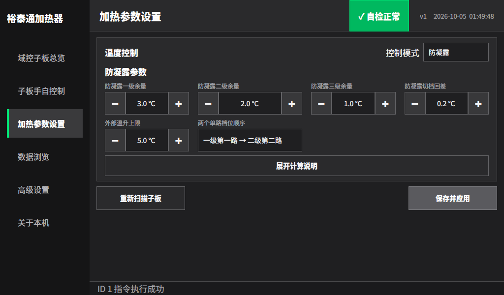

图 5　防凝露模式使用露点余量，固定目标输入隐藏。

1. 确认有效 PT100，以及至少一组可计算露点的温湿度数据。
2. 选择“防凝露”，设置三级余量、回差和外部温升上限。
3. 核对单路档位顺序及计算说明，点击“保存并应用”。
4. 回控制页启动子板，检查档位、PT100 和温湿度变化。

### 余量与档位

露点是水汽开始凝结的温度。程序分别计算三组有效温湿度的露点，取最高值。

露点余量 = 有效 PT100 均温 − 最高露点。余量越小，加热档位越高。

随附三级余量为 3／2／1 ℃，回差 0.2 ℃。从关闭开始，余量降至 2.8 ℃达到一级升档条件；一级退回关闭需升至 3.2 ℃。可使用三级加热。

随附温升上限为 5 ℃。有效外部均温高于有效 PT100 均温加 5 ℃时，计算关闭输出。

**注意**　缺少有效 PT100 或露点数据时，本轮不下发新指令。停止相关子板并排查测量，核验负载是否关闭。

<!-- pagebreak -->

## 06 查看运行及停止加热

子板手自控制

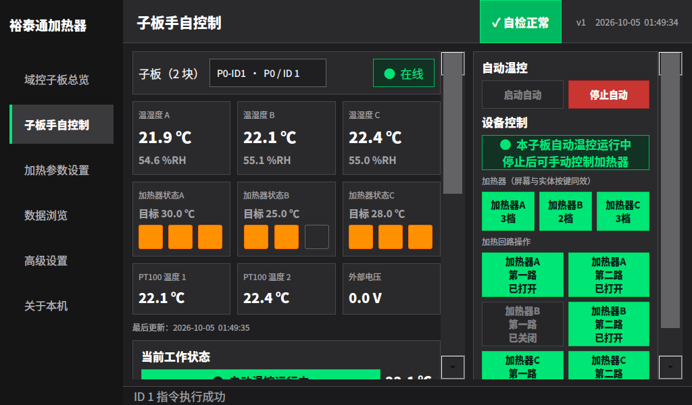

图 6　A、B、C 可处于不同档位。“停止自动”只作用于当前子板。

1. 核对子板端口、ID 和在线状态。
2. 查看温湿度、PT100 及最后更新时间持续更新。
3. 核对 A、B、C 目标与档位回读，查看底部执行提示。
4. 停止时点击“停止自动”，确认三个档位关闭、工作灯熄灭，并核验负载。

**注意**　外部电压是高压检测输入，不是加热器供电电压。

### 运行规则

启动自动先关闭本子板三个手动档位，再执行温控。自动期间三个加热器由程序控制，手动操作禁用。

切换页面或子板不停止已运行的子板。程序重启后，需逐块确认并重新启动自动。

工作灯、状态灯、报警及操作提示蜂鸣器只读。扩展闪烁灯与扩展蜂鸣器仅显示回读，尚无自动联动；备用扩展输出可手动操作。

<!-- pagebreak -->

## 07 报警处理

图 7　记录来源，排除故障，确认关闭，再恢复运行。

| 提示 | 处理范围 | 现场操作 |
| --- | --- | --- |
| 高压报警 | 停止全部自动；向已发现子板发送加热关闭指令，驱动声光告警 | 核对报警端口与 ID，排查高压来源 |
| 备用输入联锁 | 停止触发子板并发送全部加热关闭指令 | 排查该子板输入 |
| 温湿度自检异常 | 提示异常，不停止整体自动，不直接禁止手动 | 停止相关子板，检查探头与接线 |
| 通信异常或离线 | 关闭指令可能无法到达 | 检查供电与 RS485，必要时按现场断电规程处理 |

### 恢复运行

1. 记录提示文字、报警端口、ID 和发生时间。
2. 排除现场原因。不得用修改阈值代替故障排除。
3. 确认检测恢复、告警解除，加热回路实际关闭。
4. 按影响范围逐块选择子板，点击“启动自动”。

**注意**　高压或备用输入恢复后，自动不会自行重启。高压期间禁止重扫及相关手动加热。

### 自检与时间异常

温湿度自检最多等待 60 秒，取得完整读数可提前正常。温度超出 -40～85 ℃或湿度超出 0～100 %RH 时报警，连续 3 次正常后恢复。自动计算排除超量程温度；无有效温度时跳过本轮。

串口恢复后，确认在线、更新时间、档位回读和负载。“系统时间异常”表示启动时间比上次记录早超过 1 分钟。校正系统时间后重启程序；每次断电丢时间时检查 RTC 电池。异常期间仍采集，记录时间可能错误。

<!-- pagebreak -->

## 08 实体按键配置

高级设置 → 接口配置 → 外扩输入接入配置

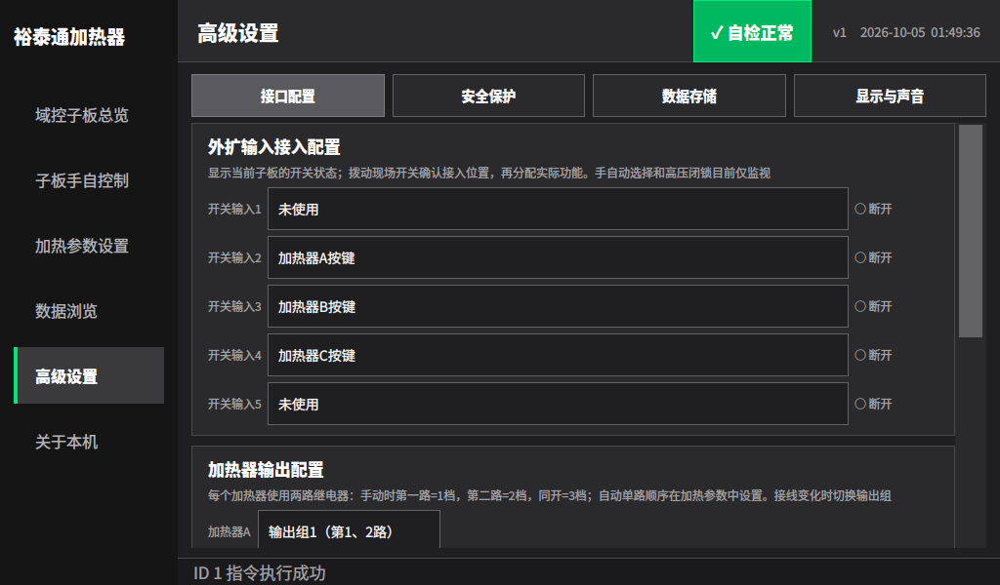

图 8　右侧状态对应控制页当前选中的子板。

1. 在控制页选择待核对子板，再进入本页。
2. 按下一个实体按键，观察输入 1～5 中哪行变为闭合；释放后确认断开。
3. 将该行设为“加热器A按键”“加热器B按键”或“加热器C按键”。不用的输入设为“未使用”。
4. 向下滚动，点击“保存并应用”，确认保存成功。
5. 回控制页，在手动且无联锁时按下并释放。确认同名加热器只切一档，档位及工作灯一致。

**注意**　自动、离线或联锁时拒绝手动加热。通信较慢时，过短按键可能未被采集。

### 仅显示状态的选项

“手自动选择”和“高压闭锁”目前仅显示状态，不执行启停或高压联锁。启停使用控制页按钮；高压检测在“安全保护”配置。

五路外扩输入与“备用联锁输入”是不同功能，不能互相替代。

<!-- pagebreak -->

## 09 输出接线与备用接口

高级设置 → 接口配置 → 加热器输出配置

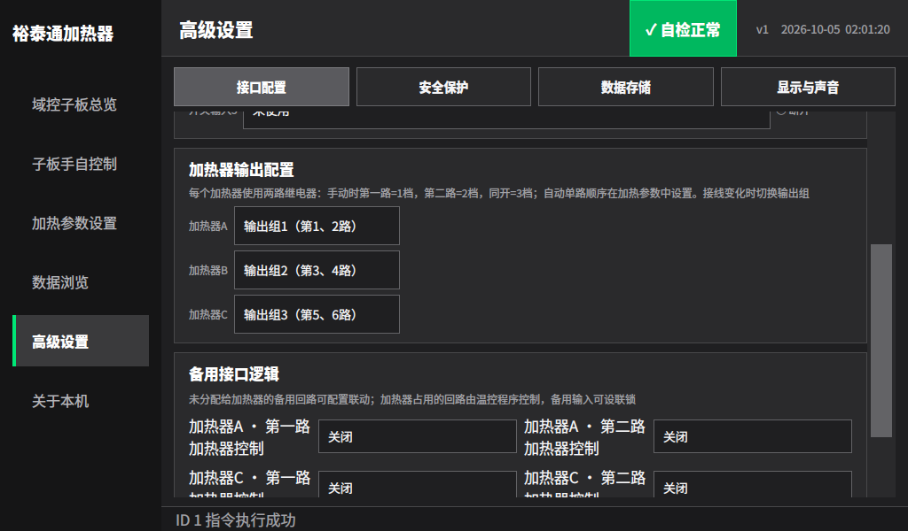

图 9　输出组指定每个加热器使用的两路继电器。

1. 在允许停机、负载安全时，核对 A、B、C 接线。
2. 选择各自输出组：1 组为第 1、2 路，依次至 5 组的第 9、10 路。
3. 确认三个输出组不重复，点击“保存并应用”。
4. 核对旧、新回路关闭及工作灯熄灭，再手动试运行各档位。
5. 按实际功率核对单路档位顺序，逐块恢复自动。

**注意**　更改输出组会停止全部自动，并向旧、新加热回路发送关闭指令。重复输出组不能保存。

### 备用输出

加热器占用的回路不执行备用配置。未占用的可配置回路可设安全关闭、手动控制、跟随自动、跟随报警或跟随指定主回路。

名称随用途变化；原状态灯回路被加热器占用后，以加热器用途为准。

### 备用联锁输入

可设仅监视、高电平联锁或低电平联锁。仅监视只显示状态。联锁触发时，停止当前子板并发送加热关闭指令，不直接停止其他子板。

<!-- pagebreak -->

## 10 高压检测与继电器保护

高级设置 → 安全保护

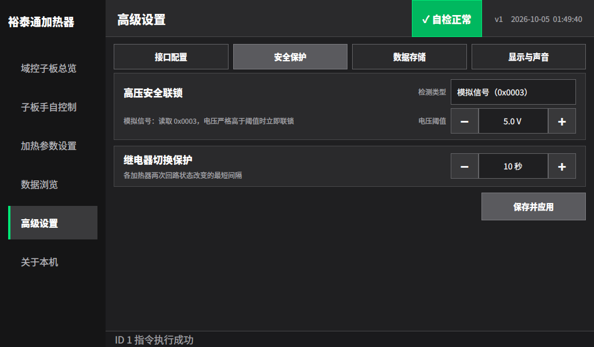

图 10　检测类型与触发值按现场传感器设置。

1. 根据传感器选择“模拟信号”或“数字信号”。
2. 模拟信号填写电压阈值；数字信号选择触发值 0 或 1。
3. 设置继电器最短切换间隔，点击“保存并应用”。
4. 按验收规程核验读数、报警来源和实际关断，再投入运行。

| 类型 | 触发条件 | 核对项 |
| --- | --- | --- |
| 模拟信号 | 电压严格高于阈值；等于不触发 | 传感器标定、读数及阈值 |
| 数字信号 | 输入等于所选的 0 或 1 | 正常与报警电平 |

**注意**　随附值为模拟量、高于 5.0 V 触发。该值不是通用安全阈值，须按现场核定。

### 继电器间隔

最短间隔可设 1～3600 秒，随附值 10 秒，用于减少自动输出频繁切换。达到温控边界后，可能等待剩余间隔才切档。

高压关闭指令不受此间隔延迟；实际关断仍须通信成功并由子板执行。

<!-- pagebreak -->

## 11 显示与声音

高级设置 → 显示与声音

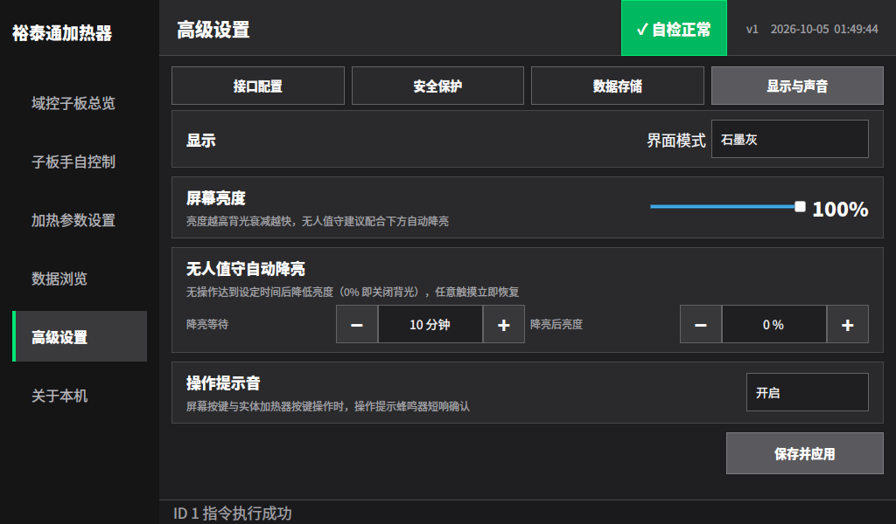

图 11　设置亮度、空闲降亮时间和提示音。

1. 选择标准、低光、强光、石墨灰或鸿蒙主题。
2. 拖动亮度滑条，范围 5～100%。
3. 设置降亮等待时间和降亮后亮度。
4. 选择是否开启提示音，点击“保存并应用”。
5. 等待降亮后，触摸或按键，确认背光恢复。

| 设置 | 含义 |
| --- | --- |
| 降亮等待 0 分钟 | 关闭自动降亮 |
| 降亮后亮度 0% | 空闲后关闭背光 |
| 随附设置 | 空闲 10 分钟后降至 0% |

**注意**　自动降亮只改变背光，温控和记录继续运行。屏幕变暗时，先触摸或按键唤醒。亮度调节须设备支持。

主题立即生效并单独保存；未保存离开时选择“不保存”，亮度预览恢复，主题保留。报警和运行含义不随主题改变。

提示音不表示指令执行成功。只读指示和逐路回路操作不额外触发硬件提示音。

<!-- pagebreak -->

## 12 历史查询

数据浏览

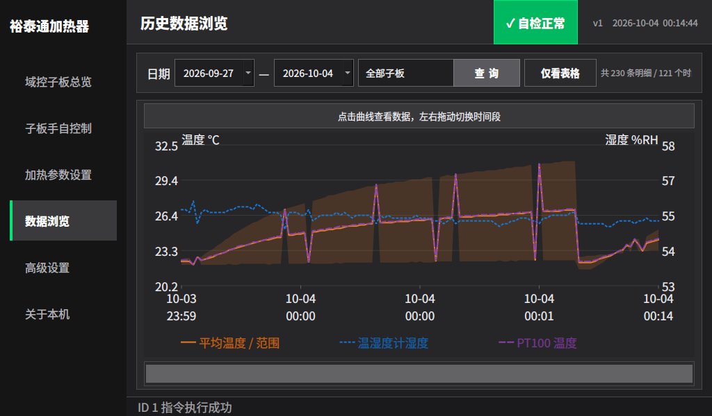

图 12　上方设置日期和子板，下方滚动条切换时段。

1. 选择开始日期、结束日期和子板，点击“查询”。
2. 查看平均温度、平均湿度及 PT100 均温曲线；点击曲线查看时间点详情。
3. 左右拖动曲线或底部滚动条，查看其他时段。
4. 点击“仅看表格”，查看时间、子板、平均温湿度及高压状态。

### 数据显示规则

- 单板曲线对应所选子板；历史中的离线子板仍可查询。
- “全部子板”按秒聚合，主温度曲线为各子板平均温度的总体平均，橙色带为最低至最高范围。排查单板时单独选择该子板。
- 表格保留单板明细，最多显示最新 500 条；曲线抽样显示。界面显示数量不代表全部记录数量。
- 查询后跟随最新；拖回旧数据暂停，拖到最右恢复。出现追加上限提示时，重新查询。

**备份**　界面无独立导出按钮，由维护人员复制实际日志目录。

查询为空时，核对日期、子板、时间和日志位置；再检查是否取得有效数据并达到记录周期。

<!-- pagebreak -->

## 13 数据记录与日志清理

高级设置 → 数据存储

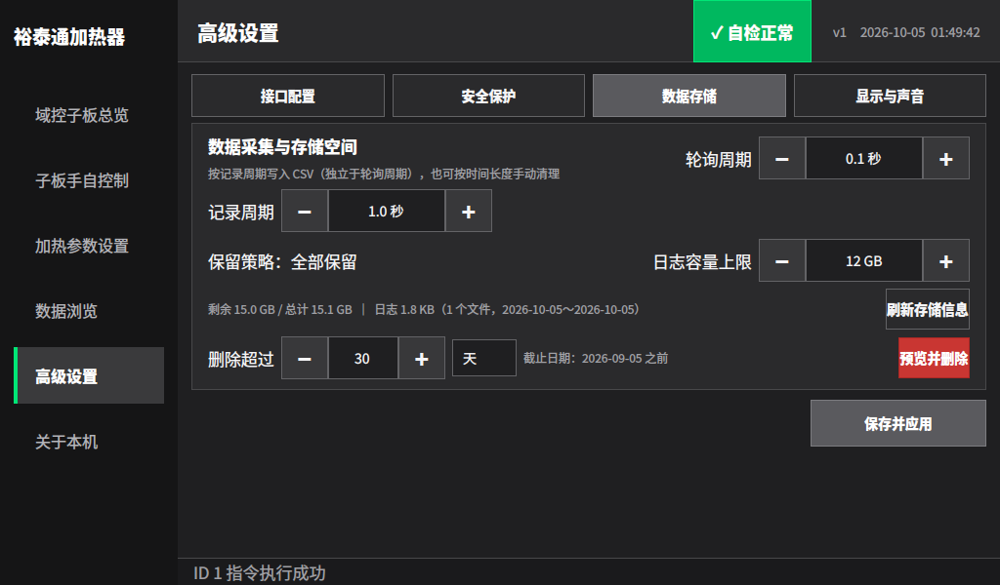

图 13　先设置记录参数；清理时核对截止日期和删除预览。

### 设置记录

1. 设置轮询周期及记录周期，各为 0.1～3600 秒。
2. 设置日志容量上限，范围 1～100 GB，点击“保存并应用”。
3. 点击“刷新存储信息”，查看空间、文件数量及日期范围。

轮询决定测量及控制更新，记录决定写入频率。随附值为 0.1 秒／1 秒／12 GB。加快记录不能提高实际采集频率，多板或通信超时会影响更新。超出容量后，从最旧文件开始清理。

### 手动清理

1. 备份需保留的文件，确认设备日期正确。
2. 设置“删除超过”的数量及天、月或年单位，核对截止日期。
3. 点击“预览并删除”，核对文件数量和大小，再确认。
4. 刷新存储信息，检查文件数量及日期范围。

**注意**　删除无法在软件内撤销。只删除截止日期之前的合法日期文件，截止日期当天保留。例如 2026 年 10 月 5 日清理超过 30 天的记录，删除 9 月 5 日之前的文件。

日志保存为 YYYY-MM-DD.csv，随附目录为 data/logs，实际位置由部署决定。新格式保存子板身份、三路温湿度、两路 PT100、电压、备用输入和第 1～6 路继电器；不包含全部灯状态和参数。

<!-- pagebreak -->

## 14 故障排查与交接

| 现象 | 检查与处理 |
| --- | --- |
| 未找到或缺少子板 | 查供电、线序、端口和地址。启动每口只找第一块；允许停止全部自动时重扫，完成后逐块启动。 |
| 自动运行但不加热 | 查在线、联锁、测量有效性及模式输出条件。核对计算说明和继电器间隔；写入失败时检查通信。 |
| 实体按键不切档 | 查输入状态变化、功能分配及自动／联锁状态。在手动下按下并释放，核对输出组和回读。 |
| 历史为空或不完整 | 查日期、子板、时间、日志目录及清理情况。表格只显示最新 500 条。 |
| 设置未保留 | 查保存是否成功，离开时是否选“不保存”。保存失败时检查目录权限和可用空间。 |
| 屏幕变暗或熄灭 | 先触摸或按键唤醒，再查运行状态及自动降亮设置。 |

### 随附配置

设备已保存设置以界面为准；高压阈值和接线须现场验收。

| 项目 | 随附值 |
| --- | --- |
| 模式／目标来源 | PID 三档输出／固定温度 |
| A／B／C 目标 | 30／25／28 ℃ |
| A／B／C 输出组 | 1／2／3，即第 1、2／3、4／5、6 路 |
| 外扩输入 | 输入 2、3、4 分别为 A、B、C 按键；1、5 未使用 |
| 高压／备用输入 | 模拟量高于 5.0 V 触发／仅监视 |
| 轮询／记录／继电器间隔 | 0.1 秒／1 秒／10 秒 |
| 日志上限 | 12 GB |
| 显示与声音 | 石墨灰，亮度 100%；空闲 10 分钟降至 0%；提示音开启 |

**交接**　核对子板端口与 ID、探头读数、加热器接线与功率顺序、联锁、目标、时间及日志位置。

**报修**　提供端口、ID、发生时间、提示文字、控制模式和现场现象，保留相关时段日志。
